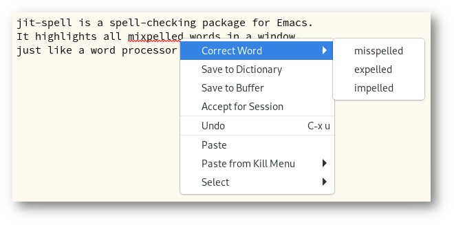

#+title: jit-spell --- Just-in-time spell checking

#+html: 

jit-spell is a spell-checking package for Emacs.  It highlights all
misspelled words in a window, just like a word processor or web
browser does.

#+caption: Correcting a misspelling with jit-spell

This behavior is different from the built-in Flyspell package, which
only checks words as the cursor moves over them.

jit-spell is part of [[https://elpa.gnu.org][GNU ELPA]] and can be installed with =M-x
package-install RET jit-spell RET=.  As a complement, you may also
want to install the [[https://github.com/astoff/vibe-spell][vibe-spell]] package; see section “Engines” below.

** Usage

To enable spell checking in a buffer, type =M-x jit-spell-mode RET=.
To correct a misspelling, you can right-click the word (assuming you
have =context-menu-mode= activated) or call the command
=jit-spell-correct-word=, which uses the minibuffer to read a
correction or accept the word.

To make your settings permanent, you may wish to add some variant of
the following to your init file:

#+begin_src emacs-lisp
(add-hook 'text-mode-hook 'jit-spell-mode)
(add-hook 'prog-mode-hook 'jit-spell-mode)
(with-eval-after-load 'jit-spell
  (keymap-set jit-spell-mode-map "C-;" 'jit-spell-correct-word))
#+end_src

Try also =M-x customize-group RET jit-spell RET= to see a listing of
all possible customization options.

** Language selection

Type =M-x jit-spell-dictionary RET= to choose a different spelling
language (or languages).  You also call that command with a prefix
argument in order to save the dictionary choice permanently, either as
a [[https://www.gnu.org/software/emacs/manual/html_node/elisp/File-Local-Variables.html][file-local variable]] or [[https://www.gnu.org/software/emacs/manual/html_node/elisp/Directory-Local-Variables.html][dir-local variable]].

Moreover, you can set the default dictionary by customizing the
variable =jit-spell-dictionary=.  If it is nil, the default dictionary
is determined by the “legacy” =ispell-dictionary= variable or your
system's locale setting.

** Major mode support

Often there are regions of the buffer that should be ignored for
spell-checking purposes.  In most cases, no additional configuration
is necessary.

The simplest mechanism to make adjustments is the user option
=jit-spell-ignored-faces=.  Any word fontified with one of these faces
in this list ignored by jit-spell.  To find out which faces are
present on a given character, you can use the =describe-char= command.

In all programming language modes, spell checking is restricted to
comments, docstrings and strings.  This can be modified by customizing
the variable =jit-spell-prog-mode-faces=.

** Spellchecking engines

jit-spell supports two spellchecking backends.  The default method is
to run a spellchecker as a subprocess, using the standard =ispell -a=
interface.  This forces us to compute all correction suggestions for
misspellings eagerly, even if they will never be used.  As a
consequence, it takes (visibly) longer to complete and uses more
systems resources.  That said, since jit-spell runs asynchronously, it
should not slow down Emacs itself.

As a better performing alternative, jit-spell can use [[https://github.com/astoff/vibe-spell][vibe-spell]], a
port of Hunspell to pure Emacs Lisp.  It is selected automatically as
the jit-spell backend when available, so it suffices to install that
package with the following command:

#+begin_src
M-x package-vc-install RET https://github.com/astoff/vibe-spell RET
#+end_src

** Contributing

Discussions, suggestions and code contributions are welcome!  Since
this package is part of GNU ELPA, contributions require a copyright
assignment to the FSF.
